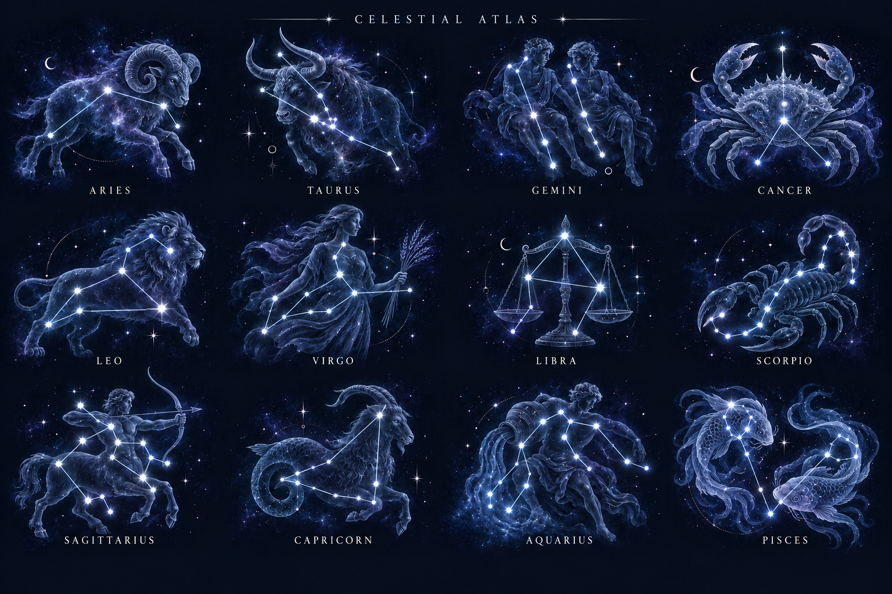
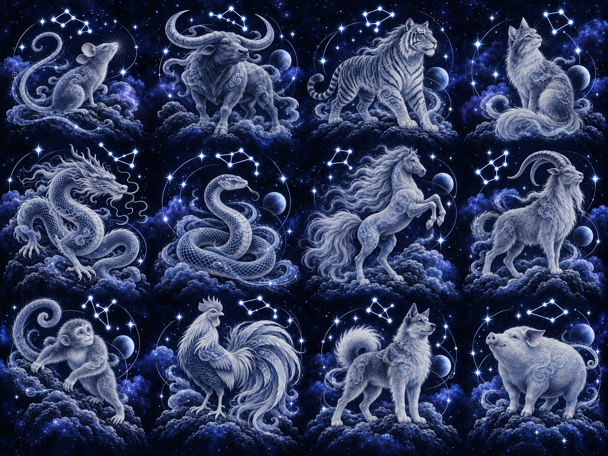

# Approved celestial Zodiac artwork

The owner approved these two final blue collections for upload to `docs/zodiac-sign-assets-v2`, under `zodiac-sign/`. These are original, non-personal generated illustrations. Existing Western SVG defaults in `assets/zodic-sign/` are preserved.

## Western collection

Twelve signs in four columns, read left to right:
- Aries, Taurus, Gemini, Cancer
- Leo, Virgo, Libra, Scorpio
- Sagittarius, Capricorn, Aquarius, Pisces

Approved changes: faint engraved figures behind bright constellations; legendary crab guardian for Cancer and paired spirit fish for Pisces; refined Aries and Taurus horns and ethereal details. Use the image as artistic reference, not as a verified astronomical chart.

## Vietnamese collection

Twelve animals in four columns, read left to right:
- Tý – Chuột; Sửu – Trâu; Dần – Hổ; Mão – Mèo
- Thìn – Rồng; Tỵ – Rắn; Ngọ – Ngựa; Mùi – Dê
- Thân – Khỉ; Dậu – Gà; Tuất – Chó; Hợi – Heo

Approved direction: blue/silver celestial linh vật, sculptural horns, flowing cloud and fur motifs, noble animal expressions and luminous star signatures. Contemporary fantasy interpretations; no claim that these are historical sacred designs. Mão is a cat and Sửu is a water buffalo. Vietnamese star maps are invented decorative motifs.

## Delivery status and production handoff

**Artwork approval and source-sheet delivery are complete. These are raster PNG contact sheets, not SVG files or 24 individually exported production images.** They preserve exactly the approved generated artwork; no vector tracing or replacement drawings were substituted. `manifest.json` records dimensions, exact file sizes, SHA-256 checksums, and sign positions.

- Western source: 1536 × 1024, 2,529,318 bytes, including the atlas heading and labels.
- Vietnamese source: 1448 × 1086, 3,356,328 bytes.
- Before website integration, prepare one square image per sign (12 per system) with deliberate padding and visual review. Do not load these large masters directly in the guest screen. The Western sheet includes labels/heading that need attention during export; do not blindly divide it into squares.
- Target approximately 150 KB or less per processed image, using WebP/AVIF where the future pipeline supports them. Measure sizes and visual quality after export. No such performance claim is made for these original source masters.
- If editable vector artwork remains required, it is a separate follow-up. A PNG placed inside an SVG is not a true vector conversion.
- Keep labels as localized UI text in production and choose a licensed Vietnamese-capable serif font separately; the generated serif lettering is not an identifiable font asset.
- Static images now. Dynamic stars or other motion can be added at integration with reduced-motion support. Bake soft blur into image exports to avoid continuous runtime blur work.

## Collection and privacy contract

Keep Western and Vietnamese artwork in distinct collections with stable namespaced sign IDs. Selecting a system must select its matching labels and calculation; artwork does not calculate signs. Western and Vietnamese calculations remain distinct, with Vietnamese lunar-year boundaries and UTC+7 behavior governed by the current PRD/data model.

This delivery changes artwork only. It does not change the current couple-only Zodiac data model or introduce a guest birthday form. Guests continue to view only the owner-authorized published data. The current PRD and design 3 remain authoritative; earlier chat examples about guest-entered dates are not product requirements.

Production must avoid result-dependent image requests: load all 12 images for the displayed system independently of the private date/result. Do not expose birth data or computed sign in asset URLs, logs or analytics. Page-owned replacement uploads stay in private storage as defined by design 3 §3.3; this repository exception is limited to these explicitly approved non-personal built-in source illustrations.

## Verification

Both PNG files decode successfully, their dimensions match the manifest, and upload blob hashes are checked against the exact approved local bytes. Existing branch content is retained; upload is a non-forced update on top of the current branch head. No application code or runtime integration is included.
